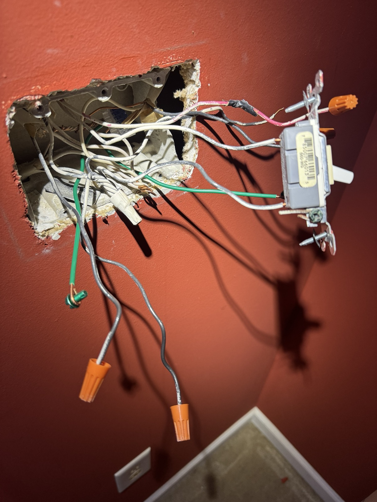

{.preview-image fig-alt="iPhone camera photo of an open 3-gang junction box on a wall, with wires chaotically spilling out like tentacles from some kind of [Eldrazi horror](https://mtg.fandom.com/wiki/Eldrazi)."}

Today is Day Two of unplanned homelab downtime, and while the initial anxiety in my brain has settled down as the inevitability of a Day Three (and likely Four) looms, I can feel a deeper anxiety slowly gathering and pushing for a *plan*.

The original plan had been to take down the homelab for just a few hours on Thursday, at worst the full day. But I began by replacing some dead light switches in my home office (these had been dead for Y-E-A-R-S).

As with any homelab, home improvement, or (let's be real) "project" in general, things quickly spiraled: it took significantly longer than I'd initially hoped just to identify the wires I was working with^[HOLY SHIT Y'ALL, THESE SWITCHES WEREN'T GROUNDED. IN A 2006 BUILD. WT ACTUAL F.], and so in trying to close up until Friday, I somehow missed that *this junction box passed the ENTIRE room's circuit through it*: in leaving two of the switches disconnected, that broke some circuit that otherwise powered all the other lights and outlets in the room.

Including the one that our home internet and wifi was hooked up to. This made me spiral a bit.

I broke out a heavy extension cord that tided us over for that night, and today I managed to install new switches (and correctly! took a single false start and a third [lever connector](https://www.homedepot.com/p/IDEAL-In-Sure-Lever-Wire-Connector-12-AWG-3-Port-Bag-of-50-30-05L23/320628223) to get the wiring right) that restored power in the room.

But consequently, I never got to any of the homelab maintenance work and upgrades I'd planned. I'd been kind of hoping to do it this weekend, but with Halloween on the horizon---plus a 10+ mile long run, and a *very* exhausting week behind me^[This was supposed to be my *week OFF*, and I spent it with gut issues, contractor woes, and homelab snafus. From my body's perspective, I have not rested; in fact, I've had one of the most stressful weeks all year.]---I'm not sure that's a reasonable expectation.

So yeah, maybe I should just switch everything back on and try again some other time. Would be nice to have Mastodon again. And my wildlife sensors. And my file transfer service. And my media server. And my smart home trappings. And... yeah I'll probably just do that.

It would fix the deeper anxiety. I'll just have to find another time for the planned maintenance and upgrades.

